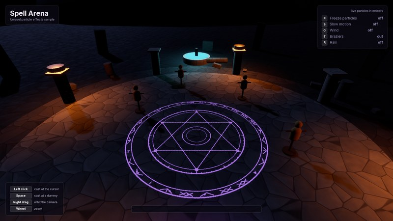
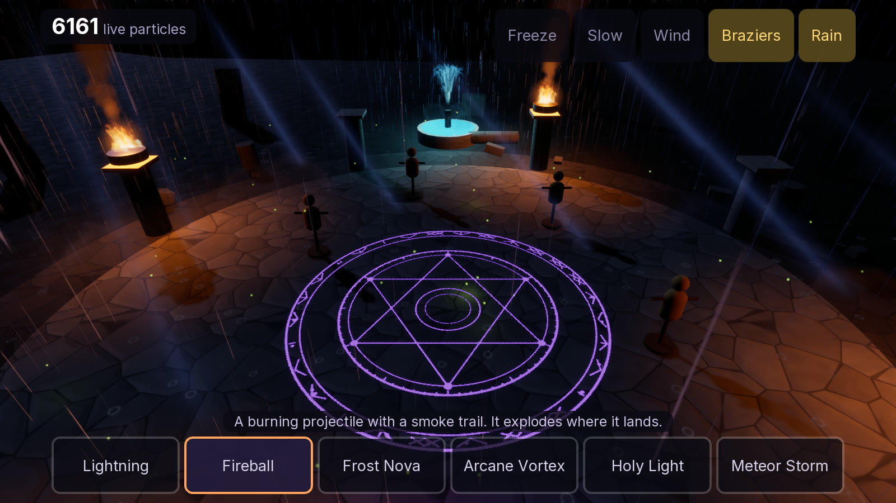
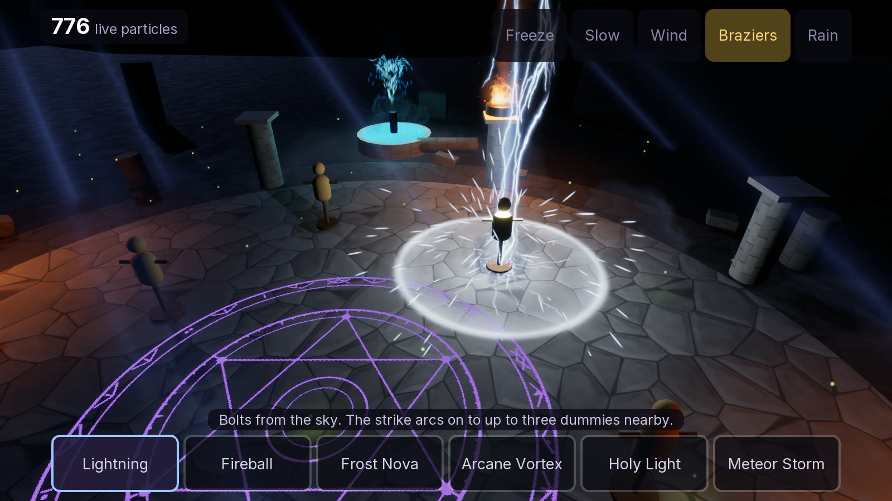
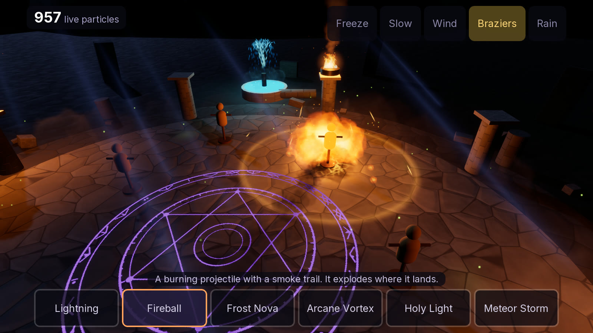
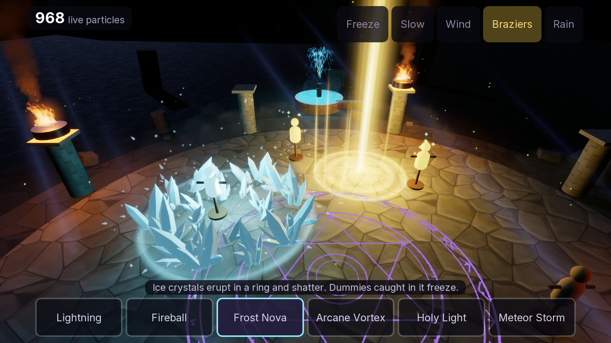
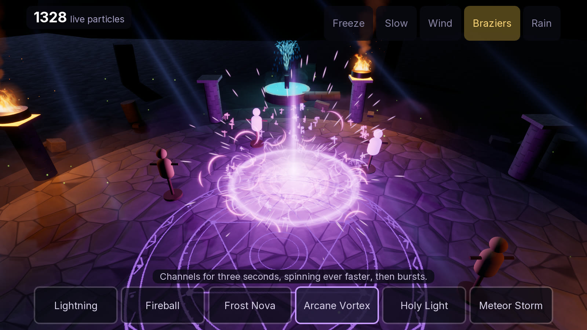
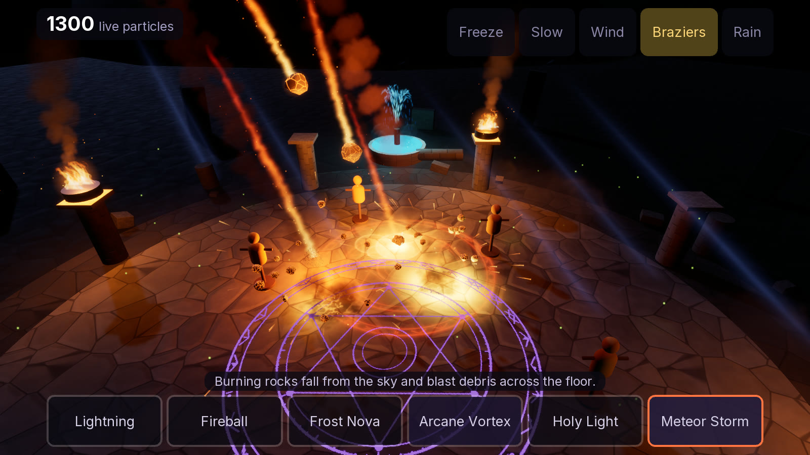

# Spell Arena

A night arena where spells play out: lightning, fireball, frost nova, arcane vortex, holy light and a meteor storm,
among braziers, embers, mist, fireflies and rain. It shows the engine's GPU particles with sub-emitters, ribbons,
mesh particles, soft, lit and volumetric-lit particles, particle lights and collision, and the C# scripts that cast
them. A sample project for [Unravel Engine](https://github.com/unravel-dev/UnravelEngine).

## Play

Clone this repository, or get it from the Samples page of the Unravel editor's start page, and open its folder in
the editor. Open `data/Scenes/SpellArena.spfb` and press Play; it is also the startup scene of a deployed build.

| Action | Keyboard and mouse | Gamepad | Touch |
|---|---|---|---|
| Pick a spell | 1 - 6, a spell slot | - | A spell slot |
| Cast at the cursor | Left click on the floor | - | Tap the floor |
| Cast at a random training dummy | Space | - | - |
| Freeze or resume every emitter | P, its switch | - | Its switch |
| Put out or light the braziers | T, its switch | - | Its switch |
| Wind on or off | G, its switch | - | Its switch |
| Slow motion on or off | B, its switch | - | Its switch |
| Rain on or off | R, its switch | - | Its switch |
| Orbit the camera, zoom | Right-drag, wheel | - | Drag one finger, pinch |

Casts land on the floor within 10.5 m of the arena's centre, and a spell cast while the emitters are frozen hangs in
the air. The HUD shows the live particle and emitter counts, and switches to a touch layout on a touch screen. There
are no gamepad controls.

## What it shows

### Spells

Each spell is a script in `data/Scripts/Spells/` (deriving from `Spell.cs`) whose emitters are child entities in the
scene.

1. **Lightning** (`LightningSpell.cs`): a charge, then three strikes down the same channel, then arcs that chain to
   up to three dummies. Burst `Emit`, `EmitParams` to place one arc between two points, vertical and horizontal
   billboards, align to direction, a soft flash.
2. **Fireball** (`FireballSpell.cs`): three pooled projectiles whose core and body simulate in local space and whose
   trail simulates in world space, and a layered explosion: a frame-blended flipbook, smoke, debris, a dust ring and
   a scorch mark.
3. **Frost Nova** (`FrostNovaSpell.cs`): ice crystals from `Prefabs/FrostCrystals.pfb` taken from an `EntityPool`,
   shards with eased motion, mist, a frost decal and snow.
4. **Arcane Vortex** (`ArcaneVortexSpell.cs`): a pooled prefab of 13 emitters, `Prefabs/ArcaneVortex.pfb`, with
   local-space spirals and prewarm, emission rates raised every frame while it channels, then a burst.
5. **Holy Light** (`HolyLightSpell.cs`): vertical-billboard beams, a rune circle, rings and heal marks placed with
   `Emit` at a position.
6. **Meteor Storm** (`MeteorStormSpell.cs`): mesh particles (the rock model with its own material), collision that
   kills the rock and fires ten impact sub-emitters, bouncing debris with its own dust sub-emitter, ribbons spawned
   by distance travelled, sparks in trail mode, particle lights on the flash, core and embers, and smoke lit by the
   scene with a normal-mapped sheet at half resolution.

### Ambient effects

- **Braziers** (`Brazier.cs`, `Flicker.cs`): vertical-billboard fire with frame blending, embers and lit,
  normal-mapped smoke.
- **Ground mist**: volumetric-lit, soft particles at half resolution.
- **Fireflies**: 24 particle lights moved by turbulence.
- **Moon shafts**: the fixed-axis render mode.
- **Mana fountain**: spray, splash and mist.
- **Spell focus**: motes, wisps and a halo in local space, turned by `Spinner.cs`.
- **Rain**: stretched, volumetric-lit drops killed by a collision plane, with splashes and droplets as sub-emitters.
- **Wind** (`WindAffected.cs`): adds to the acceleration of the emitters it touches.

## Screenshots

| | |
|---|---|
|  |  |
|  |  |
|  |  |

## Project layout

| Path | What it holds |
|---|---|
| `data/Scenes/SpellArena.spfb` | The arena: 133 emitters, 15 lights and 4 training dummies. |
| `data/Scripts/Arena/` | `SpellCaster` (input, casting, the arena switches), `ArenaHud` (the HUD's data model), `Brazier`, `TrainingDummy` (glows and wobbles when hit). |
| `data/Scripts/Spells/` | `Spell` (the base class: slot, info, cooldown, sound, helpers) and one script per spell. |
| `data/Scripts/Common/` | `Flicker`, `LightFlash`, `OrbitCamera` (orbit, zoom, shake), `Spinner`, `WindAffected`. |
| `data/Prefabs/` | `ArcaneVortex` and `FrostCrystals`. |
| `data/Textures/VFX/`, `Particles/`, `Arena/` | The effect sheets, an older sprite set, and the floor, pillar and sigil textures. |
| `data/Models/`, `data/Materials/`, `data/Audio/` | The arena, ice and meteor models, the materials and the spell sounds. |
| `data/UI/arena_hud.rhtml`, `arena_hud.rcss` | The HUD. |

## Platforms

| Profile | Notes |
|---|---|
| Desktop | Windows or Linux, as the editor runs on. |
| Android | Lighter settings: textures up to 1024, half-resolution particles, no global illumination, screen-space reflections, ambient occlusion or soft and contact shadows. |

Deploy from the editor's Deploy window with a profile from `profiles/`.

## Credits

The sample uses no third-party assets: its effect textures, models and sounds were generated for it, and the HUD
uses the Inter typeface that ships with the engine. Code and all other content are under the MIT license in
[LICENSE](LICENSE).
